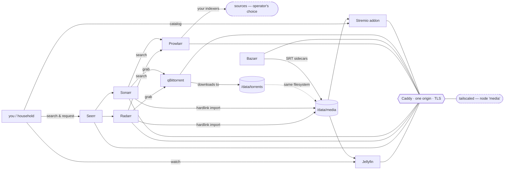

# homelab

[](https://github.com/AydilJoe/homelab/actions/workflows/addon.yml)
[](LICENSE)

A self-hosted media stack for a single box — the `*arr` suite for acquisition,
Jellyfin for playback, Seerr for requests, and a custom Stremio addon that
serves the local library. Everything sits behind one Caddy origin with TLS
issued by Tailscale, so there is one hostname, one certificate, and nothing
exposed to the internet.

Built for an unprivileged Proxmox LXC with `/dev/dri` passed through for Quick
Sync. It currently runs on a Windows dev box under Docker Desktop; every place
those two differ is recorded in an ADR rather than left as a surprise.

**What makes this different from the usual compose gist:** the failure modes
are written down. `docs/runbook.md` §6 is a list of things that actually broke
here and how they were diagnosed — silent URL-base breakage, a symlinked
tailscaled socket, a hardlink check that lies on NTFS, a `202` that persists
config without reloading it. The README's build order exists in the sequence it
does because doing it any other way costs you an afternoon.



This repo is the implementation. It was built against a written spec that is
kept private — section references throughout (§3.2, §5.2, §6.3 …) point at it.
You do not need it: every decision it drove is restated in
[`docs/decisions.md`](docs/decisions.md), and the constraints that matter are
called out inline where they bite.

---

## Step by step

The order below is the one that works. It is not the order the services appear
in `docker-compose.yml`, and **step 6 is deliberately early** — see the warning
there.

### 1 — Prepare the host

On the Proxmox host, for LXC 101:

```bash
# /etc/pve/lxc/101.conf
features: nesting=1,keyctl=1          # without these, Docker will not run
dev0: /dev/dri/renderD128,gid=104     # Quick Sync
dev1: /dev/dri/card0,gid=44
dev2: /dev/net/tun                    # tailscaled needs this

# unprivileged LXC maps container 1000 -> host 101000
chown -R 101000:101000 /srv/data
```

Gate: inside the LXC, `docker run --rm hello-world` succeeds and
`ls /dev/dri/renderD128 /dev/net/tun` shows both.

### 2 — Clone and configure

```bash
git clone <this repo> /opt/homelab && cd /opt/homelab
cp .env.example .env
```

Fill in `CONFIG_ROOT`, `DATA_ROOT`, `TZ`, `PUBLIC_BASE_URL`, `TAILNET`,
`ADDON_ADMIN_TOKEN`, and `TS_AUTHKEY` (generate at Tailscale admin → Settings →
Keys). Leave the `*arr` API keys blank — they do not exist yet.

**`CONFIG_ROOT` must not sit inside `DATA_ROOT`.** Four containers bind
`${DATA_ROOT}` at `/data`, so a nested config tree hands all of them the `*arr`
databases and API keys read-write (ADR-014).

```bash
# The addon runs as uid 1000 from its first instruction. Every other service is
# a linuxserver image that starts as root and chowns /config itself, so this is
# the only directory that needs preparing — Docker would otherwise create it
# root:root and the addon cannot write its index.
mkdir -p "$CONFIG_ROOT/addon" && chown 1000:1000 "$CONFIG_ROOT/addon"
```

### 3 — Bring up the stack

```bash
docker compose up -d      # run from THIS directory: ${CADDYFILE} is repo-relative
docker compose ps         # all Up; tailscale should report (healthy)
```

The `media` node joins the tailnet on first start and persists its identity in
`${CONFIG_ROOT}/tailscale`, so the auth key is only needed once.

Gate: `https://media.<tailnet>.ts.net/` serves the dashboard. The first
handshake can take ~20 s while tailscaled issues the certificate; after that it
is instant and renews itself.

### 4 — Jellyfin

`https://media.<tailnet>.ts.net/jellyfin/` → wizard → admin account →
libraries **Movies** → `/media/movies` and **Shows** → `/media/tv`.

Then Dashboard → Users, one account per household member, and Dashboard →
API Keys, one key for the `*arr` notifications in step 9.

### 5 — qBittorrent

`/qbittorrent/` — the temp password is in `docker compose logs qbittorrent`.
Change it, then set Downloads → save path `/data/torrents`, incomplete
`/data/torrents/incomplete`, and categories `movies` → `/data/torrents/movies`,
`tv` → `/data/torrents/tv`.

To let Radarr/Sonarr talk to it without storing its password twice, whitelist
the container bridge (Options → Web UI → bypass for whitelisted subnets):

```bash
docker network inspect medianet --format '{{range .IPAM.Config}}{{.Subnet}}{{end}}'
```

The subnet differs per host — a stale value gives the `*arr` apps 403s from a
client that tests fine by hand (manual-config 13).

### 6 — URL bases — **do this before wiring anything together**

Set each app's own base path so Caddy can serve every UI from one origin:

| App | Setting | Value |
|-----|---------|-------|
| Jellyfin | Dashboard → Networking → Base URL | `/jellyfin` |
| Radarr | Settings → General → URL Base | `/radarr` |
| Sonarr | Settings → General → URL Base | `/sonarr` |
| Prowlarr | Settings → General → URL Base | `/prowlarr` |
| Bazarr | Settings → General → Base URL | `/bazarr` |

Restart each container afterwards — the setting persists to `config.xml` but is
**not** reloaded until restart, which looks exactly like it failed to save.

> **Why this step is here and not later.** Every internal caller must carry the
> base path too. Doing this after wiring silently breaks four integrations —
> the `*arr` → Jellyfin notifications, Prowlarr → Radarr/Sonarr, the addon's
> `RADARR_URL`/`SONARR_URL`, and Seerr's services. None of them error visibly;
> the addon just falls back to Cinemeta and library refreshes stop. Setting the
> bases first means every later step uses the right URL from the start.
> Full write-up: manual-config 19, runbook 6.9.

qBittorrent has no URL-base setting, so Caddy strips its prefix and rewrites
`Origin`/`Referer` instead. Nothing to configure there.

### 7 — Radarr and Sonarr

Root folders `/data/media/movies` and `/data/media/tv`. Download client
qBittorrent at host `qbittorrent`, port `8080`, categories `movies` / `tv`,
credentials blank if you did the subnet whitelist. Enable **Use Hardlinks
instead of Copy**. Quality profiles per §9 — prefer H.264 + AAC.

### 8 — Prowlarr

Settings → Apps → add Radarr (`http://radarr:7878/radarr`) and Sonarr
(`http://sonarr:8989/sonarr`), Prowlarr URL `http://prowlarr:9696/prowlarr`,
sync level Full Sync.

**Indexers are yours.** Prowlarr ships empty and the build leaves it that way
(§13). Nothing downloads until you add at least one. New indexers reach the
`*arr` apps on Prowlarr's own timer; force it with
`POST /api/v1/command {"name":"ApplicationIndexerSync"}`.

### 9 — Wire the integrations

```bash
# API keys are generated on first run; read them without opening the UIs
grep -o '<ApiKey>[^<]*' "$CONFIG_ROOT"/{radarr,sonarr}/config.xml
```

- Put them in `.env` as `RADARR_API_KEY` / `SONARR_API_KEY`, then
  `docker compose up -d addon` so the addon's primary resolution path works.
- Radarr/Sonarr → Settings → Connect → **Emby/Jellyfin**: host `jellyfin`,
  port `8096`, **URL base `/jellyfin`**, Jellyfin's API key, Update Library on.
  Triggers: import, upgrade, rename, delete.

### 10 — Seerr

`https://media.<tailnet>.ts.net:5055` — its own TLS port, because Seerr has no
subpath support (ADR-017).

Sign in with Jellyfin: server `jellyfin`, port `8096`, URL base `/jellyfin`,
SSL off. Set the **External URL** to
`https://media.<tailnet>.ts.net/jellyfin` or "Play on Jellyfin" links point at
the internal container address. Sync both libraries, add Radarr and Sonarr with
their base paths, then Settings → Users → import from Jellyfin.

If the service dialog closes without saving — it does that — use
`POST /api/v1/settings/{radarr,sonarr}` instead. `activeLanguageProfileId` must
be a number, not null.

### 11 — Timers and backups

Inside the LXC:

```bash
chmod +x scripts/*.sh
cp systemd/homelab-backup.{service,timer} /etc/systemd/system/
cp systemd/homelab-rescan.{service,timer} /etc/systemd/system/
systemctl daemon-reload
systemctl enable --now homelab-backup.timer homelab-rescan.timer
systemctl start homelab-backup.service          # prove it once
```

`homelab-rescan.timer` reconciles the addon index every 15 minutes — Jellyfin
self-heals via its filesystem watcher, the addon does not (open item O4).

### 12 — Verify

```bash
scripts/verify.sh 1        # ... through 7
```

The gate that matters most is the hardlink check — see below.

---

## Everything is one origin

| What | Where |
|---|---|
| Dashboard | `https://media.<tailnet>.ts.net/` |
| Jellyfin | `/jellyfin/` (apps: just the bare host) |
| Radarr · Sonarr · Prowlarr · Bazarr | `/radarr/` `/sonarr/` `/prowlarr/` `/bazarr/` |
| qBittorrent | `/qbittorrent/` |
| Stremio addon | `/addon/manifest.json` |
| Media files | `/media/...` |
| Seerr | `:5055` (own TLS port — no subpath support) |

The addon's own port is bound to `127.0.0.1:7000` deliberately: `/admin/*` is
reachable only from a shell on the box, and Caddy answers 403 for
`/addon/admin/*`. Do not loosen either — tailscaled shares this network
namespace, so a `0.0.0.0` bind would publish it tailnet-wide.

## Ingress modes

| | `caddy/Caddyfile` (active) | `caddy/Caddyfile.lan` | `caddy/Caddyfile.tshost` |
|---|---|---|---|
| Transport | HTTPS via tailscaled | plain HTTP `:80` | HTTPS from a pre-issued cert |
| Renews itself | yes | n/a | **no — 90 days** |
| Use when | normal | no tailnet at all | superseded, kept for reference (ADR-015) |

Switching is one line in `.env` (`CADDYFILE=`), plus `PUBLIC_BASE_URL` to match.
The active file also keeps a plain-HTTP `:80` site so LAN devices without
Tailscale still reach the dashboard — without it, Caddy redirects `:80` to an
HTTPS address the tailnet certificate does not cover.

## Read this before touching the volume mounts

**Hardlink contract (§3.2, C4).** qBittorrent, Sonarr, Radarr and Bazarr all
mount `${DATA_ROOT}` at `/data` — one mount, one filesystem, identical paths in
every container that writes. That is the only reason imports hardlink instead
of copy. Replacing those with per-service subpath mounts looks tidier and
silently doubles storage consumption.

```bash
stat -c '%h %n' /srv/data/media/movies/*/*.mkv   # link count MUST be 2
```

If it says 1, the import copied. On Windows/NTFS use
`fsutil hardlink list <file>` instead and expect two paths — `stat` reports 1
there even for genuinely linked files (ADR-014).

Read-only consumers are outside the contract and mount only what they need:
Jellyfin `/media:ro`, addon `/data/media:ro`, Caddy `/srv/media:ro`. Caddy's
own `/data` is cert storage — never mount media there.

## Build phases

Seven phases, each with a verification gate, in spec §7. **A failing gate stops
the build** — do not advance past one (§0.3).

1. Base — LXC with `nesting`/`keyctl`, `/dev/dri` + `/dev/net/tun`, Docker
2. Networking — tailscaled as node `media`, real cert
3. Media services — compose up, UIs reachable
4. **Hardlink verification** — the gate that catches the most common mistake
5. Transcode verification — Jellyfin must report "Transcoding (hw)"
6. Addon — manifest, `/health`, and a ranged GET returning **206** not 200
7. Backups — nightly timer inside the LXC, archives on `/dev/sda`

Commit after each phase completes and verifies.

## Indexers are not configured here

Prowlarr ships empty and stays empty. Indexer selection is an explicit operator
decision — the build does not select, configure, or recommend any source
(§13). The stack is source-agnostic; that one choice is what determines the
deployment's legal profile, which is why it belongs to the operator.

## Decisions in effect

- **O2 — duplicate qualities:** several files for one title return **all** of
  them as separate streams, best first (resolution desc, then size desc).
- Caddy's Caddyfile is mounted from this repo (`${CADDYFILE}`) rather than from
  `${CONFIG_ROOT}/caddy` as in §4, so every ingress config stays under version
  control (ADR-013 — costs: compose must run from the repo directory).
- tailscaled runs as a **container** named `media`, and Caddy shares its network
  namespace so it listens on the tailnet IP (ADR-016). Ports and networks belong
  to the tailscale service, not to Caddy.
- Every UI is served at a path on one origin; Seerr is the exception on its own
  port (ADR-017). The standing cost is that every internal caller must carry the
  base path.
- Secrets live in `.env` only. `.env` is gitignored; `.env.example` is committed
  with placeholders (§0.3).
- `.gitattributes` forces LF — this repo is authored on Windows for a Linux
  host, and CRLF breaks shell scripts and systemd units.

## Layout

```
README.md              .env.example       .gitignore  .gitattributes
docker-compose.yml
caddy/Caddyfile        tailnet ingress — ACTIVE
caddy/Caddyfile.lan    plain HTTP, no tailnet required
caddy/Caddyfile.tshost superseded (ADR-015)
caddy/site/index.html  the dashboard served at /
addon/                 the Stremio addon (§6)
scripts/               backup.sh, verify.sh, rescan.sh, tscert-renew.ps1
systemd/               homelab-{backup,rescan}.{service,timer}
docs/                  manual-config.md, runbook.md, decisions.md
```

Anything configured by clicking in a web UI must be written down in
`docs/manual-config.md` with the reason (§0.3). When something breaks quietly,
`docs/runbook.md` §6 is the list of things that have actually gone wrong here.
